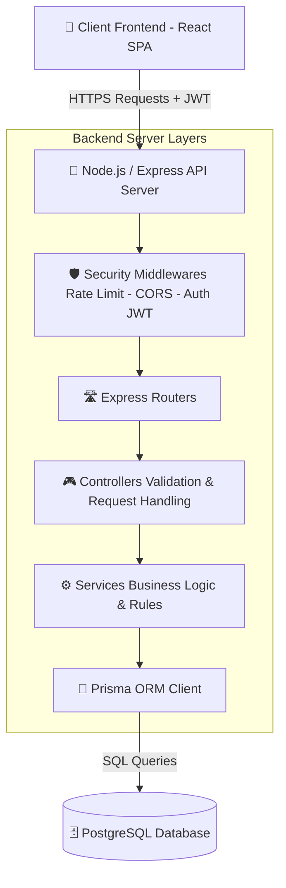

# 🏗️ ARQUITECTURA DEL SISTEMA - STOCKFLOW CONNECT

StockFlow Connect sigue una arquitectura desacoplada **Cliente-Servidor (REST API + SPA Frontend)** construida con Node.js, Express, TypeScript, Prisma ORM y React.

---

## 🧭 Diagrama de Arquitectura por Capas

---

## 📂 Organización de Capas en Backend (`backend/src`)

- **`controllers/`**: Maneja la entrada de solicitudes HTTP, extrae parámetros/cuerpos de peticiones y devuelve respuestas formateadas.
- **`services/`**: Contiene la lógica de negocio pura (ej. cálculo de vueltos, sanitización, verificación de precios $Venta \ge Costo$, generación de JWT).
- **`middlewares/`**: Filtros de seguridad.
  - `auth.middleware.ts`: Verifica la validez del token JWT enviado en la cabecera `Authorization: Bearer <token>`.
  - `rateLimiter.ts`: Previene ataques de fuerza bruta en inicio de sesión.
  - `errorHandler.ts`: Captura y responde amigablemente ante errores 500/400.
- **`routes/`**: Define los endpoints y asocia sus respectivos controladores y middlewares.
- **`utils/`**: Funciones auxiliares (ej. formateadores de moneda, wrappers de bcrypt, utilidades Zod).
