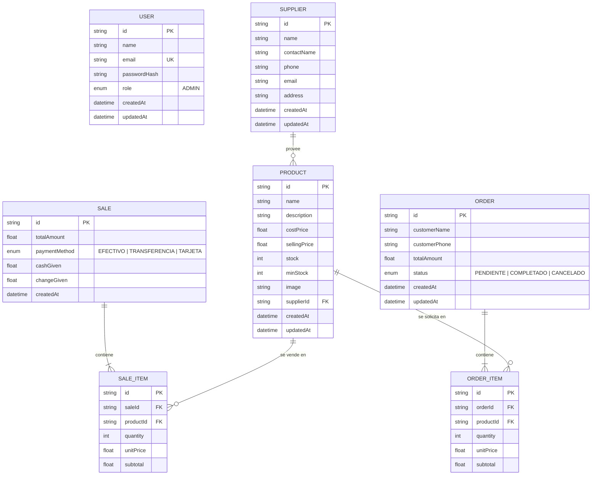

# 🗄️ MODELO Y ESQUEMA DE BASE DE DATOS - STOCKFLOW CONNECT

StockFlow Connect utiliza **PostgreSQL** como motor de base de datos relacional y **Prisma** como ORM.

---

## 📐 Diagrama Entidad-Relación (Mermaid)

---

## 📋 Resumen de Tablas y Entidades

1. **`User` (Usuarios Administradores)**:
   - Almacena las credenciales de acceso. El `email` es único. `passwordHash` utiliza algoritmo `bcrypt` con 10 salt rounds.

2. **`Supplier` (Proveedores)**:
   - Entidad obligatoria para la trazabilidad de reabastecimiento de productos físicos.

3. **`Product` (Productos del Inventario)**:
   - Contiene precios de costo (`costPrice`) y de venta (`sellingPrice`). Cumple la regla de negocio $sellingPrice \ge costPrice$.
   - Vinculado mediante clave foránea `supplierId` a la tabla `Supplier`.

4. **`Sale` & `SaleItem` (Ventas POS)**:
   - Registra cada transacción en punto de venta con método de pago, efectivo recibido y cambio entregado.

5. **`Order` & `OrderItem` (Pedidos Portal B2C)**:
   - Registra los pedidos realizados por clientes finales a través del catálogo público.
